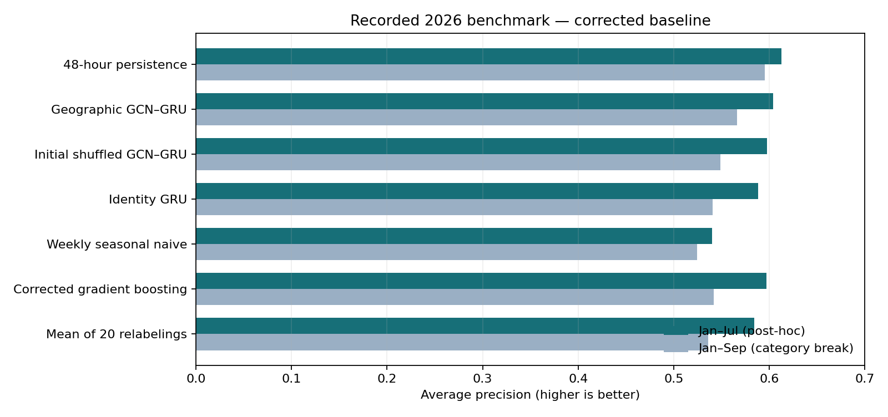
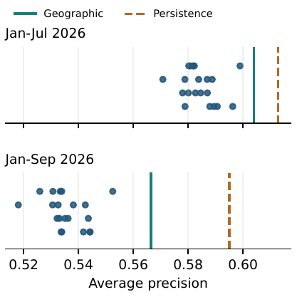
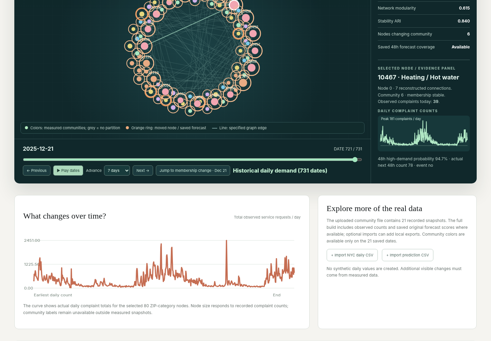

# CivicPulse-STGNN

**Geographic graphs, persistence, and distribution shift in 48-hour municipal demand forecasting.**

An empirical benchmark using real NYC 311 service-request aggregates. The study asks whether a spatial GCN–GRU adds predictive value beyond simple time-series rules and matched recurrent controls. It is a research prototype, not an emergency detector or a deployed decision system.

[Research manuscript (PDF, discussion draft)](paper/CivicPulse_STGNN.pdf) · [Dashboard files](dashboard/index.html) · [Reproduction guide](docs/REPRODUCIBILITY.md) · [Technical demonstration](docs/PROFESSOR_DEMO.md)

## Key findings

- **Persistence wins:** the preceding-48-hour count rule achieves higher AP and F1 than every evaluated trained model in both 2026 windows.
- Geographic adjacency ranks **1st of 21** topologies by five-seed mean AP among the spatial graph and 20 newly sampled full-node relabelings. Two relabelings exceed its F1 in each window. Full-node relabeling also disrupts complaint-category alignment, so this does not isolate geography alone.
- Correcting a node-history feature-layout bug and retuning histogram gradient boosting on 2025 validation improves its Jan–Jul AP from 0.3920 (invalid historical baseline) to 0.5968.
- The model is sensitive to changing demand distributions and a frozen decision threshold; April 2026 spatial F1 is approximately 0.034. Source-category discontinuities complicate the nine-month evaluation.



## Benchmark results

Neural entries are five-seed means (7, 17, 27, 37, 42); the additional relabeling row averages 20 topology means. Non-neural baselines are single runs. See the [manuscript](paper/CivicPulse_STGNN.pdf) for seed SD and uncertainty. AP is average precision, not accuracy.

| Model | Jan–Jul F1 | Jan–Jul AP | Jan–Sep F1 | Jan–Sep AP |
|---|---:|---:|---:|---:|
| 48-hour persistence | **0.5828** | **0.6128** | **0.5745** | **0.5950** |
| Weekly seasonal naive | 0.5443 | 0.5401 | 0.5371 | 0.5241 |
| Initial shuffled GCN–GRU | 0.4953 | 0.5975 | 0.4618 | 0.5487 |
| Geographic GCN–GRU | 0.4789 | 0.6040 | 0.4513 | 0.5664 |
| Identity GRU | 0.4706 | 0.5884 | 0.4390 | 0.5409 |
| Corrected histogram gradient boosting | 0.4472 | 0.5968 | 0.4183 | 0.5417 |
| Mean of 20 additional relabelings | 0.4669 | 0.5844 | 0.4354 | 0.5358 |

Jan–Jul (16,800 cases) is a post-hoc continuity sensitivity subset of Jan–Sep (21,680 cases); the windows overlap. Exact `Water System` and `Sewer` labels disappear in August–September 2026, and equivalence to maintenance labels is not proven. The original 2025 test and 2026 evaluations were inspected during development; extension results are exploratory, not fresh confirmation.



### Decision thresholds and probability diagnostics

Separate thresholds for each of the four complaint categories were selected on 2025 validation data. The five-seed mean results show that category-specific thresholds do not consistently improve pooled F1.

| Evaluation period | Global F1 | Category-specific F1 | AP |
|---|---:|---:|---:|
| 2025 validation | 0.6441 | 0.5258 | 0.7499 |
| Jan–Jul 2026 | 0.4789 | 0.4836 | 0.6040 |
| Jan–Sep 2026 | 0.4513 | 0.4387 | 0.5664 |

Brier scores and reliability-bin diagnostics assess probability quality. For the geographic GCN–GRU, mean Brier scores are 0.1925 (Jan–Jul) and 0.1833 (Jan–Sep). AP is unaffected by changing classification thresholds. See the [diagnostic evidence](paper/evidence/final_review/) and [threshold verification summary](paper/evidence/final_review/category_threshold_verified_summary.csv).

## Method


The graph consists of 80 nodes (20 selected ZIP codes × four complaint categories). Each node uses 28 days of history and ten non-graph temporal features to predict whether the sum of its next two days' complaints strictly exceeds its training-derived 75th percentile. Spatial message passing uses within-ZIP and distance-weighted same-category cross-ZIP edges. The GCN-style encoder feeds a shared node-wise GRU. The identity control retains the network but removes cross-node mixing.

The 2024–2025 source has 731 days; 482 training anchors, 108 validation anchors and 108 originally held-out test anchors. Node identities, scaler, adjacency, target cutoff, checkpoints and decision thresholds are determined using pre-2026 data. The threshold is selected on 2025 validation. See [data provenance](docs/DATA_PROVENANCE.md) and [limitations](docs/LIMITATIONS.md).

## Interactive dashboard

Open `dashboard/index.html` locally in your browser (download/clone first; GitHub's source-file viewer does not execute HTML). The standalone file embeds 731 daily observation dates, 80 nodes, 276 graph edges, 108 dates of original 2025 forecast outputs and 21 measured December 2025 community partitions. The visualization is descriptive and is not the controlled 2026 evaluation. No live API or web server is required.



## Quick start

From the repository root on macOS/Linux, using Python 3.12 or a compatible Python 3.11–3.13 environment:

```bash
python3 -m venv .venv
source .venv/bin/activate
python -m pip install -r requirements.txt
python -m pytest -q
python scripts/verify_release.py
python scripts/verify_latest_evidence.py
python scripts/verify_category_thresholds.py
```

The checks cover synthetic integration tests, tensor alignment and saved-output metrics, **not independent retraining**. To reproduce full training, obtain the two exact input CSVs and verify hashes using the [reproduction guide](docs/REPRODUCIBILITY.md). The full original data aggregates are intentionally excluded from Git; live downloads may differ from archived inputs. The dashboard contains selected derived aggregate counts, not individual complaint records.

## Repository layout

```text
src/                   Data download, graph construction, models, training
fair_ablation.py       Matched-input neural ablation
reviewer_experiments.py Historical controls and date-block bootstrap
benchmark_extension.py Corrected GBM and 20-topology extension (105 runs)
category_control.py    Category thresholds and category-preserving null implementation
validation_calibration.py Validation baselines and probability diagnostics
frozen_2026_eval.py    Original frozen evaluation
jan_jul_sensitivity.py Continuity subset
* audit scripts        Coverage and category audit (see reproduction guide)
build_showcase.py      Standalone dashboard builder
dashboard/             HTML viewer and editable template
paper/                 Latest PDF, IEEE LaTeX, figures, saved evidence archives
evidence/              Historical metrics, source audits, dashboard exports
scripts/               Verification and plot generation
tests/                 Synthetic and feature-layout tests
docs/                  Methods, caveats, release and demonstration instructions
```

## Research scope and limitations

CivicPulse-STGNN addresses the short-horizon forecasting component of urban complaint-network research. It predicts elevated complaint demand, not independently confirmed emergencies or crisis propagation. Louvain community snapshots are descriptive and separate from the forecasting benchmark.

The study is limited to one city, 20 ZIP codes and four complaint categories. Full-node relabeling does not isolate geography from category alignment; category-preserving graph controls and evaluation in a second city are directions for future work. Saved-output metrics have been independently recomputed, but the models have not been independently retrained.

For details, see the [manuscript](paper/CivicPulse_STGNN.pdf), [limitations](docs/LIMITATIONS.md) and [reproducibility guide](docs/REPRODUCIBILITY.md).

## Author and acknowledgments

**Asad Tanveer** — B.Tech, Electronics and Communication Engineering, Jamia Millia Islamia.

**Research supervisor:** [Dr. Anurag Singh](https://faculty.nitdelhi.ac.in/AnuragSingh/profile), Associate Professor, Department of Computer Science and Engineering, National Institute of Technology Delhi.

**Internship:** Palanam.

The reported model-training runs were executed by the author. OpenAI ChatGPT assisted with implementation, analysis and verification scripts, manuscript drafting and figure preparation; details are disclosed in the manuscript.

The manuscript is an unsubmitted, unreviewed research discussion paper. Supervisor acknowledgment does not imply co-authorship or institutional endorsement. Publication authorship, code licensing and institutional release permissions are subject to confirmation; see the [release checklist](docs/RELEASE_CHECKLIST.md).

**Data source:** [NYC Open Data — 311 Service Requests from 2020 to Present](https://data.cityofnewyork.us/d/erm2-nwe9).
